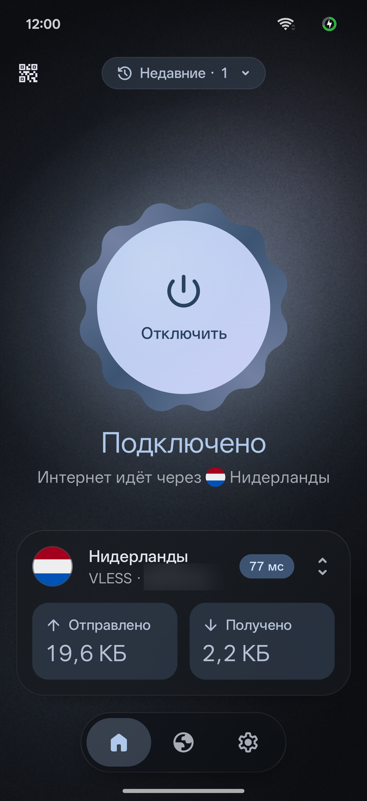
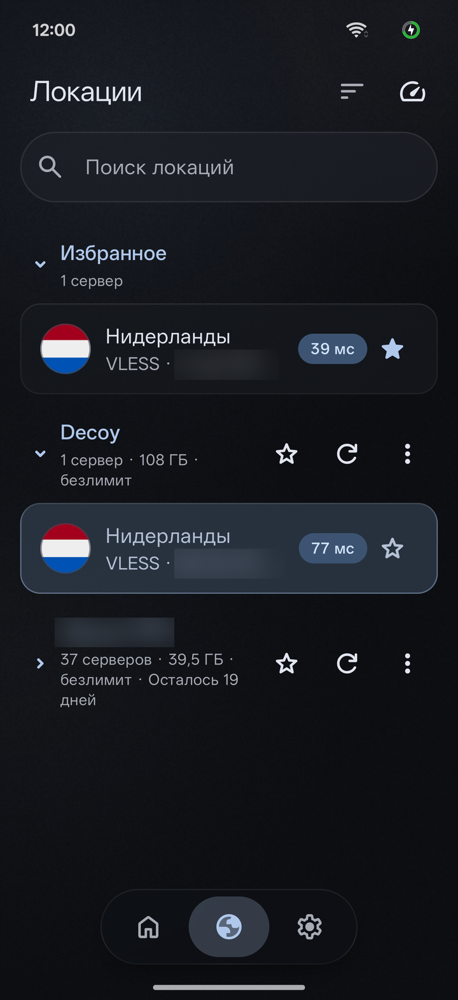
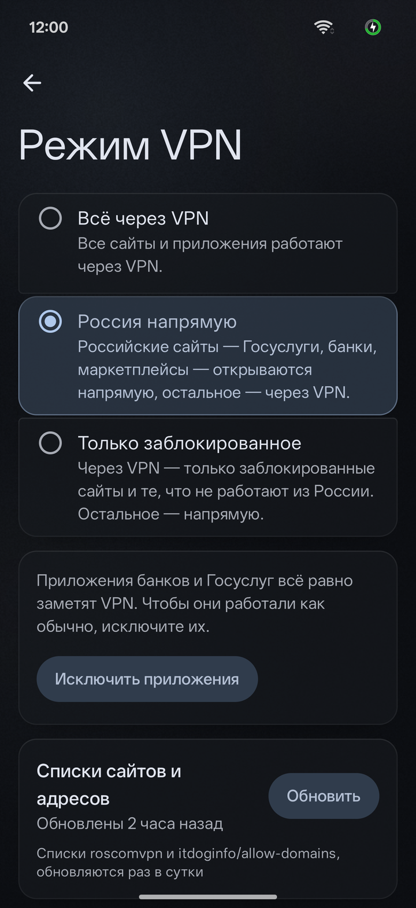

<p align="center">
  
</p>

<h1 align="center">Decoy VPN</h1>

<p align="center">
  Простой VPN для Android. Добавь ключ или подписку и подключайся одним касанием.
</p>

<p align="center">
  <a href="https://github.com/dec0iiyy/decoy-vpn-releases/releases/latest"><b>⬇ Скачать последнюю версию</b></a>
</p>

<p align="center">
  
  
  
</p>

## Как установить

1. Открой [последний релиз](https://github.com/dec0iiyy/decoy-vpn-releases/releases/latest).
2. Скачай файл `…-arm64-v8a.apk`, он подходит почти всем телефонам. Если не установится, возьми `…-universal.apk`.
3. Открой скачанный файл и разреши установку.

Нужен Android 8.0 или новее. Когда выйдет новая версия, на значке настроек загорится точка, а в самих настройках появится ссылка на скачивание.

## Что умеет

- Ключи и подписки VLESS, VMess, Trojan, Shadowsocks, Hysteria 2, SOCKS5 и HTTP. Их можно добавить по ссылке, из буфера или QR-кодом.
- Можно выбрать приложения, которые работают без VPN.
- В быстрых настройках есть плитка, чтобы включать VPN из шторки.

<details>
<summary>Проверка подписи и лицензии</summary>

Все версии подписаны одним ключом. Отпечаток сертификата (SHA-256):

```
B1:35:11:4D:AB:24:59:70:4C:24:F2:43:3B:2F:A0:6A:CB:D9:51:C7:E2:48:5E:AB:54:32:1D:46:E4:6B:D4:58
```

Контрольные суммы файлов лежат в `SHA256SUMS.txt` в каждом релизе.

Код приложения закрыт. VPN-движок [xray-rust](https://github.com/aimalygin/xray-rust) распространяется под лицензией MPL-2.0. Его исходники с нашими правками лежат [здесь](https://github.com/dec0iiyy/xray-rust). Полный список библиотек и их лицензий есть в приложении: «Настройки» → «О приложении».

</details>
